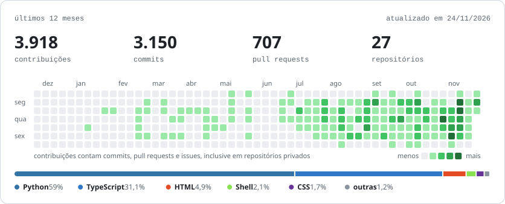
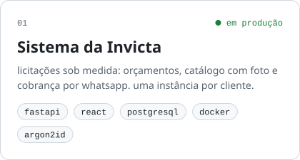
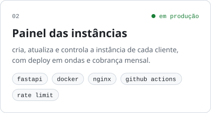
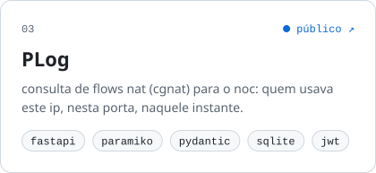
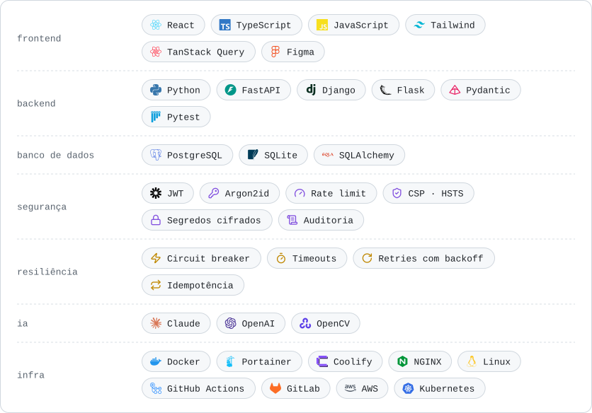

<picture>
  <source media="(prefers-color-scheme: dark)" srcset="assets/estatisticas-escuro.svg">
  
</picture>

 

### olá, pessoal. me chamo itallo.

formado em **análise e desenvolvimento de sistemas** e cursando pós-graduação em **python**.

atuo nos projetos **do início ao fim**, do banco de dados ao serviço no ar, com **segurança** em cada etapa:

- **banco**: modelagem, migrações e consultas que aguentam o dia a dia.
- **servidor**: subo os serviços, aponto o domínio e direciono o tráfego.
- **segurança**: senhas com argon2id, jwt com refresh em cookie httponly, rate limit e cabeçalhos de segurança, desde o primeiro commit.
- **resiliência**: timeouts, retries com backoff, circuit breaker e idempotência, pra uma integração fora do ar não derrubar o sistema.
- **ci/cd**: cada mudança passa pelos testes e vai pro ar sem deploy na mão.
- **testes**: unitários e de ponta a ponta, pra mexer no código sem medo.

 

### projetos

<picture><source media="(prefers-color-scheme: dark)" srcset="assets/projeto-invicta-escuro.svg"></picture>&nbsp;<picture><source media="(prefers-color-scheme: dark)" srcset="assets/projeto-painel-escuro.svg"></picture>
<a href="https://github.com/itallohmp/plog-v2"><picture><source media="(prefers-color-scheme: dark)" srcset="assets/projeto-plog-escuro.svg"></picture></a>

o sistema da invicta e o painel são privados, de cliente. o funcionamento dá pra mostrar numa call.

 

### stack

<picture><source media="(prefers-color-scheme: dark)" srcset="assets/stack-escuro.svg"></picture>

 

### contato

[github](https://github.com/itallohmp)

 

os números lá de cima são reais e se atualizam todo dia. <a href="scripts/gerar.py">veja como</a>.
